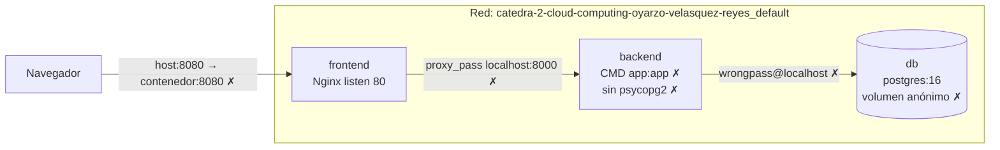
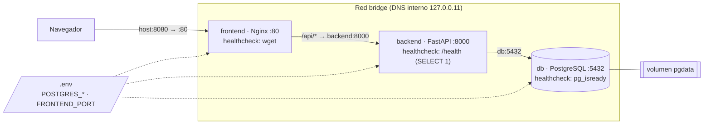

# Arquitectura

## Inicial (paquete recibido)



## Final (reparada)



Arranque: `db (healthy) → backend (healthy) → frontend`. Solo se publica el puerto 8080.
````

> GitHub dibuja automáticamente los diagramas `mermaid`. Sirven para la sección "diagrama de arquitectura" que pide el repo.